# Сборка и проверка 4-битного сумматора

Сумматор с последовательным переносом (ripple-carry), собранный из 77 дискретных
полевых транзисторов. Складывает два 4-битных числа и входной перенос:
A + B + Cin, результат от 0 до 31 горит на пяти светодиодах.

---

## Как это работает

- **Вентиль И-НЕ** — два n-МОП транзистора последовательно и резистор 10 кОм к +5 В.
  Выход становится 0, только когда открыты оба транзистора, то есть оба входа = 1.
- **Полный сумматор** (один разряд) — 9 вентилей И-НЕ: 18 транзисторов, 9 резисторов.
  Складывает три бита A, B, Cin и выдаёт сумму S и перенос Cout.
- **Перенос.** Если в разряде получилось 2 или 3, в нём остаётся 0 или 1, а единица
  уходит в следующий разряд, как «1 в уме» при сложении столбиком. Выход Cout разряда i
  подключён ко входу Cin разряда i+1. Перенос бежит от младшего разряда к старшему,
  отсюда название «последовательный».
- **Как читать светодиоды.** Слева направо: Cout S3 S2 S1 S0, веса 16 8 4 2 1.
  Пример: горят Cout и S0 → 16 + 1 = 17.

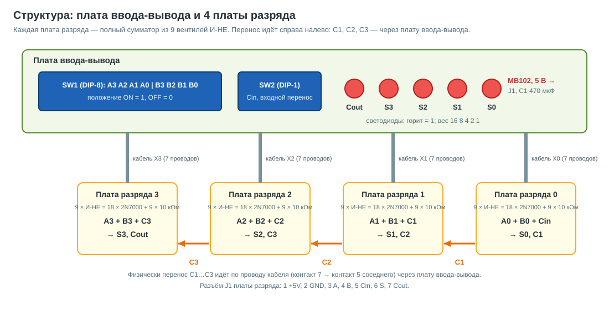

---

## Проверка в симуляторе

Схема собрана и проверена в Falstad CircuitJS. Открыть: ссылка в
[sim/falstad-link.txt](sim/falstad-link.txt). Щёлкайте по переключателям вверху,
результат горит на светодиодах внизу. Та же схема текстом лежит в
[sim/adder4.txt](sim/adder4.txt) (Файл → Импорт из текста).

В симуляторе 9 переключателей нарисованы группами 4 + 4 + 1. На плате это
SW1 (DIP-8) — все биты A и B, и SW2 (DIP-1) — Cin.

---

## Состав

| деталь | всего | плата разряда ×4 | плата ввода-вывода |
|---|---|---|---|
| транзистор 2N7000 | 77 | 18 × 4 = 72 | 5 |
| резистор 10 кОм | 45 | 9 × 4 = 36 | 9 |
| резистор 470 Ом | 5 | — | 5 |
| светодиод 5 мм | 5 | — | 5 |
| DIP-переключатель на 8 позиций | 1 | — | 1 (SW1) |
| DIP-переключатель на 1 позицию | 1 | — | 1 (SW2) |
| электролит 470 мкФ (100–470) | 1 | — | 1 |
| штыри PLS | 28 | PLS-7 × 4 | — |
| гнездо PBS-7 | 4 | — | на концах кабелей |
| макетная плата 7×9 см (24×30 отверстий) | 5 | 4 | 1 |
| одножильный провод 22–24 AWG | ~12 м, из них ~6 м на кабели | — | — |
| модуль питания MB102 | 1 | — | — |

**Питание от MB102.** Перемычку выхода на MB102 поставить на **5 В**, не на 3,3 В:
у 2N7000 порог открывания до 3 В, на 3,3 В схема будет работать ненадёжно.
Два провода припаять к штырькам 5V и GND модуля, другие концы впаять в отверстия
A22 (+5V) и A24 (GND) платы ввода-вывода (место J1, штырьки J1 тогда не нужны). См. чертёж 13.
Перед подключением проверьте мультиметром, что на штырьке 5V
действительно около 5 В. Потребление около 50 мА.

---

## Схемы и чертежи

Всё лежит в [schematics/](schematics/). Обозначения (R1, Q1, HL1…) одинаковые на
схемах, чертежах и в списке монтажа.

**Начинать с 14 и 15** — там все детали нарисованы как выглядят и все соединения линиями.

| файл | что это |
|---|---|
| [14_full_system](schematics/14_full_system.svg) | **вся схема целиком**: MB102 → плата ввода-вывода → 4 кабеля → 4 платы разряда |
| [15_bit_board_full](schematics/15_bit_board_full.svg) | **плата разряда изнутри**: 9 ячеек, все провода линиями, разъём J1 |
| [16_bit_board_steps](schematics/16_bit_board_steps.svg) | **плата разряда по шагам**: детали → провода тремя группами → пайка снизу → проверка мультиметром |
| [01_structure](schematics/01_structure.svg) | структура: какие платы и как соединены |
| [02_full_adder_logic](schematics/02_full_adder_logic.svg) | разряд на логическом уровне: 9 вентилей И-НЕ |
| [03_bit_board_schematic](schematics/03_bit_board_schematic.svg) | разряд на транзисторах (принципиальная) |
| [04_io_board_schematic](schematics/04_io_board_schematic.svg) | плата ввода-вывода (принципиальная) |
| [05_bit_board_top](schematics/05_bit_board_top.svg) / [06_bit_board_bottom](schematics/06_bit_board_bottom.svg) | плата разряда: детали и провода сверху, пайка снизу |
| [07_io_board_top](schematics/07_io_board_top.svg) / [08_io_board_bottom](schematics/08_io_board_bottom.svg) | плата ввода-вывода: сверху и снизу |
| [09_to92_pinout](schematics/09_to92_pinout.svg) | цоколёвка 2N7000 и как ставить на плату |
| [10_cell_closeup](schematics/10_cell_closeup.svg) | **одна ячейка крупно**: где ножки, что к чему загибать и паять, как провод входит в отверстие; разрезы сбоку |
| [11_bit_board_wiring_map](schematics/11_bit_board_wiring_map.svg) | плата разряда «на просвет»: провода стрелками + таблица «откуда → куда, что там» |
| [12_io_board_wiring_map](schematics/12_io_board_wiring_map.svg) | то же для платы ввода-вывода |
| [13_io_board_explained](schematics/13_io_board_explained.svg) | **плата ввода-вывода по частям**: шины питания, MB102, C1, цепочка «рычажок → резистор» и «резистор → светодиод → транзистор» |
| [wiring.md](wiring.md) | **список монтажа**: каждая деталь, шина, перемычка и провод по отверстиям, с галочками |

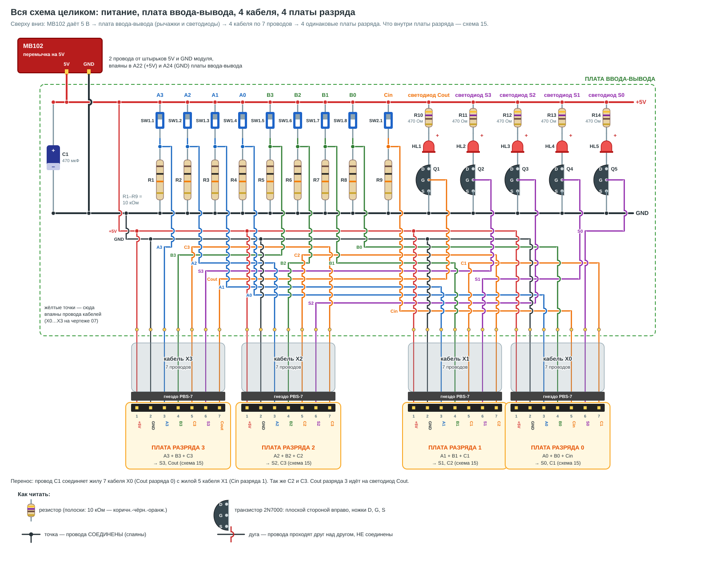

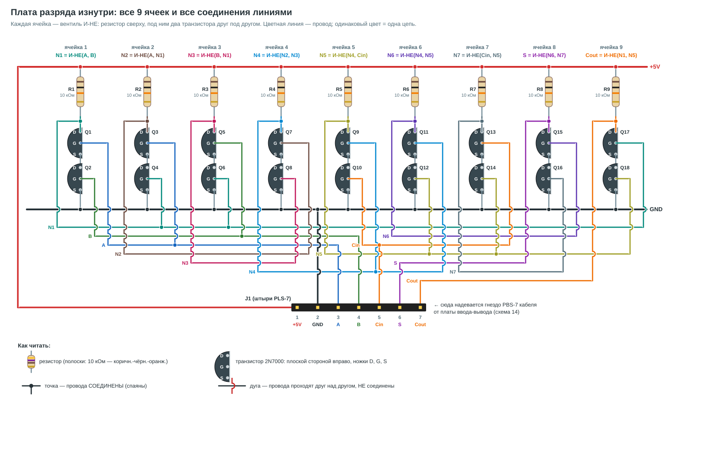

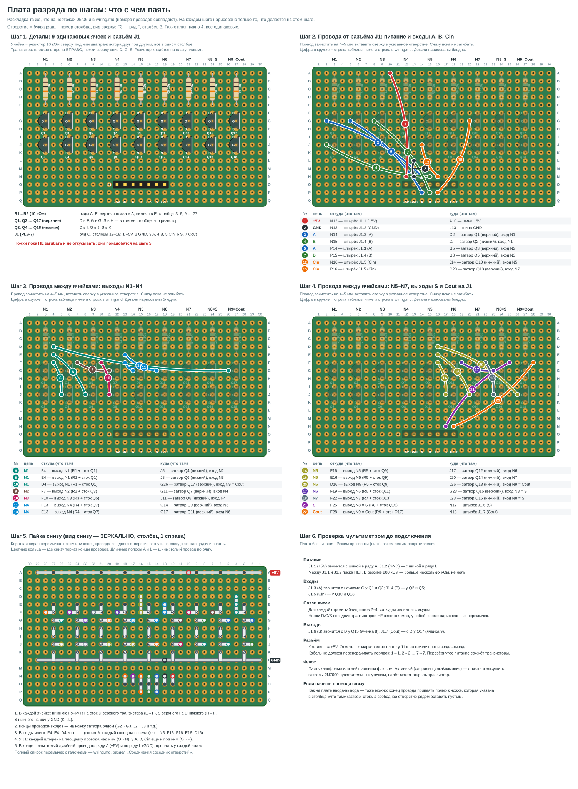

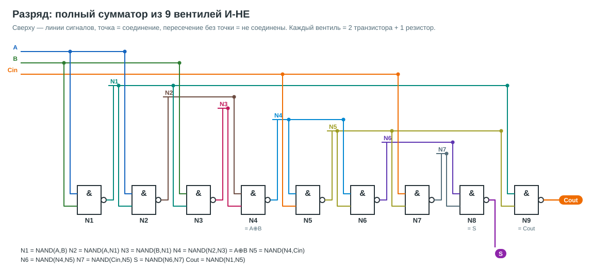

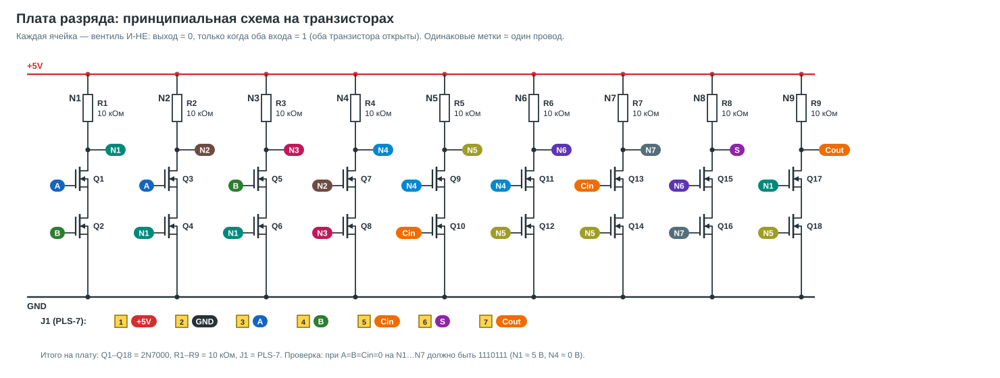

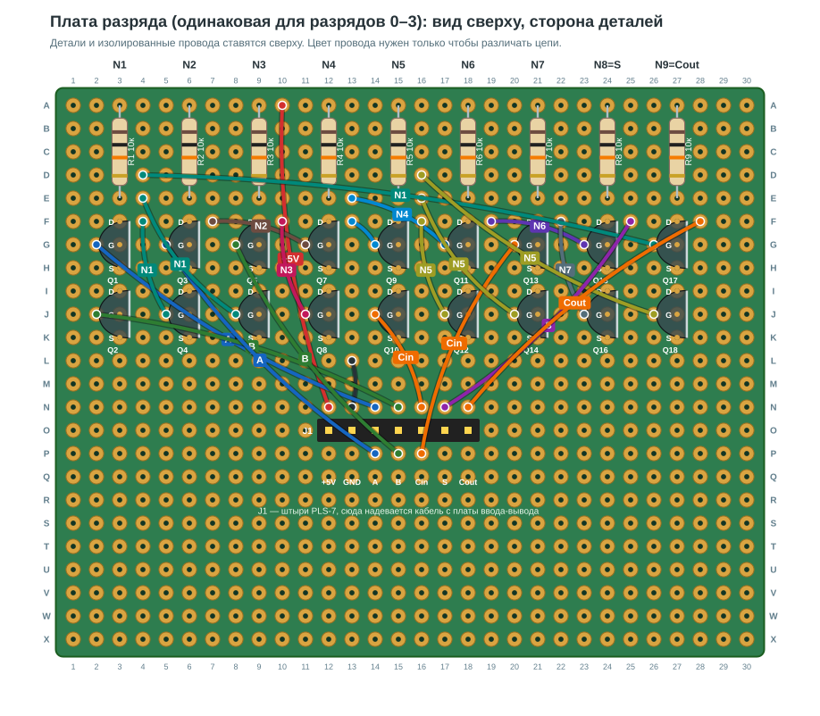

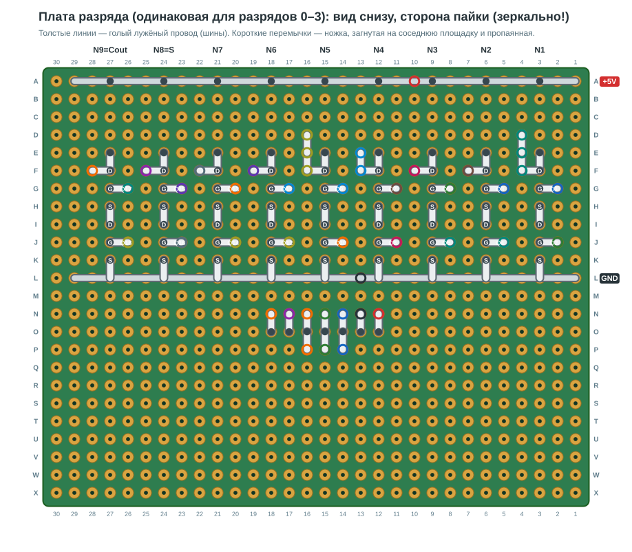

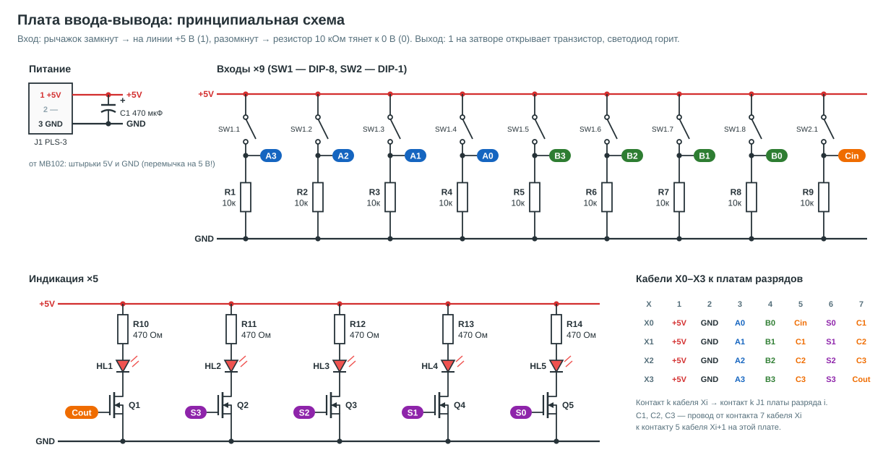

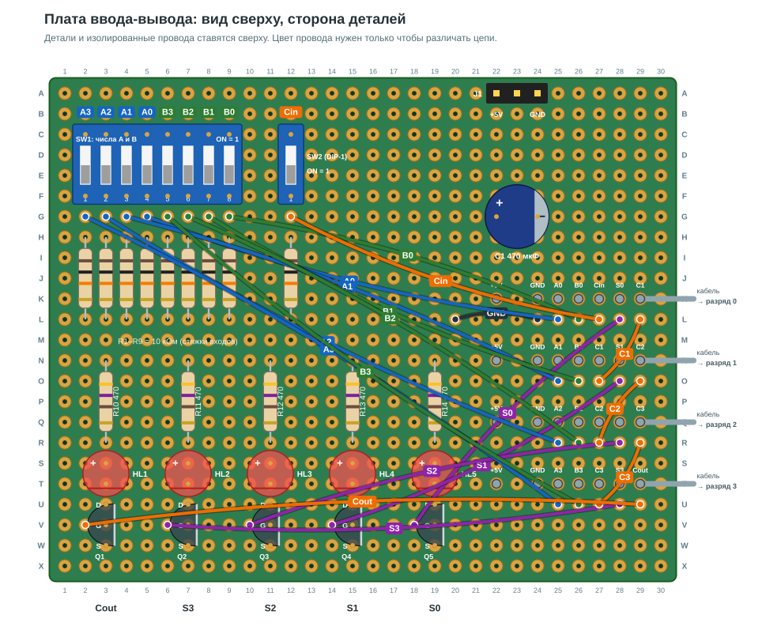

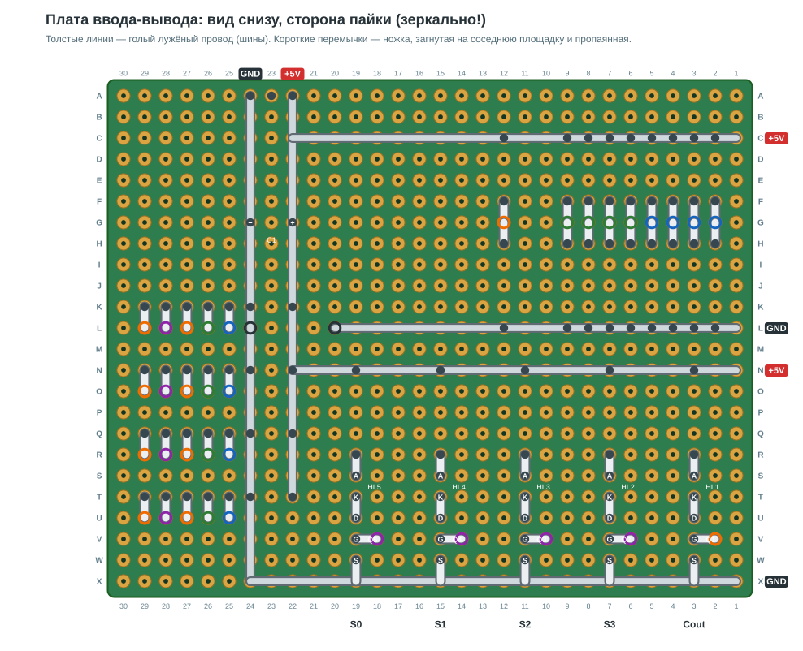

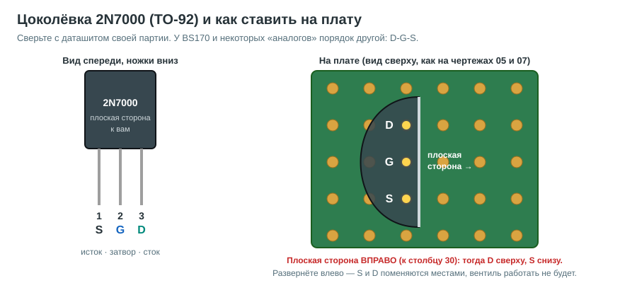

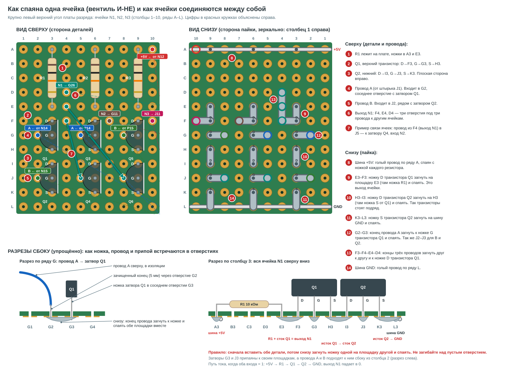

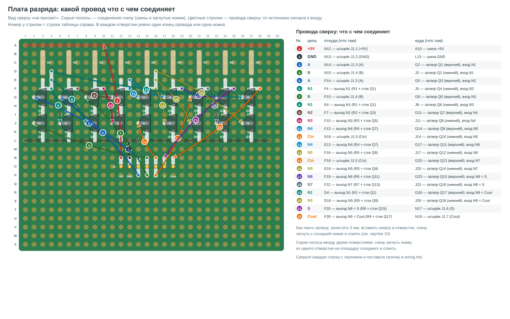

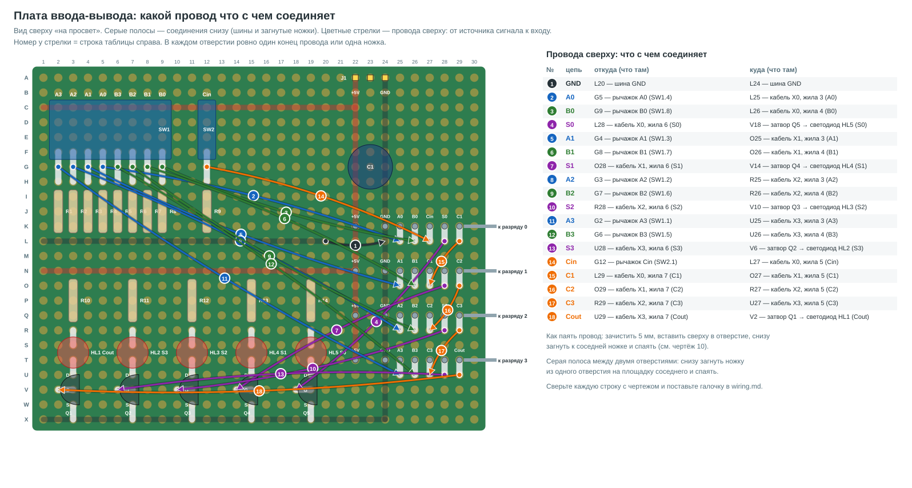

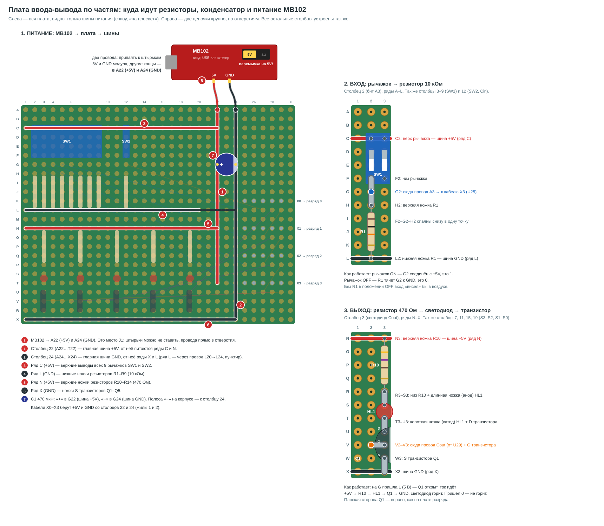

**Как читать чертежи плат.** Отверстие = буква ряда (A…X сверху вниз) и номер столбца
(1…30 слева направо, если смотреть сверху): `F3` — ряд F, столбец 3. Вид снизу
**зеркальный**: столбец 1 там справа. Цвет проводов нужен только чтобы различать цепи,
провод может быть любого цвета.

- **Шина** — голый лужёный провод снизу вдоль ряда или столбца (+5V и GND).
- **Перемычка** — соединение двух соседних отверстий снизу: ножку детали (или конец провода)
  загнуть на площадку соседнего отверстия и спаять вместе.
- **Провод** — изолированный одножильный провод сверху, концы в свободных отверстиях.

Раскладка проверена программно ([tools/boards.py](tools/boards.py)): из чертежа
извлекаются все соединения, собирается система из 5 плат и 4 кабелей, и перебираются
все 512 положений переключателей. На каждом шаге сверяются светодиоды и узлы N1–N7
каждого разряда, а также нет ли КЗ питания и затворов, висящих в воздухе.
Нарочно испорченные чертежи (перепутанный провод, пропущенная перемычка) проверка ловит.

---

## Как собрать

**Сначала:**

- Посчитайте отверстия на плате. Чертежи рассчитаны на 24 × 30. Плата ввода-вывода
  занимает её целиком, поэтому на меньшей плате раскладку придётся переделать.
- Проверьте цоколёвку 2N7000 из своей партии по даташиту. Стандарт: плоская сторона к себе,
  ножки вниз → 1 S, 2 G, 3 D. Мультиметр в режиме диода: красный щуп на S, чёрный на D
  показывает 0,5–0,8 В (встроенный диод), наоборот — обрыв.
- На плате все транзисторы стоят **плоской стороной вправо** (к столбцу 30), тогда D сверху.
  Развернёте — S и D поменяются местами.
- У TO-92 ножки бывают с шагом 1,27 мм: аккуратно разведите их пинцетом на 2,54 мм.
- Транзисторы боятся статики: перед работой коснитесь заземлённого металла,
  паяльник с заземлением, ножки не трогать лишний раз.

**Как паять соседние отверстия.** Ножку не обрезать сразу: снизу загнуть её на
площадку соседнего отверстия, где уже стоит ножка другой детали или конец провода,
и пропаять обе площадки вместе. Лишнее обрезать после пайки. Одна капля припоя
без ножки держится плохо и легко даёт непропай. Правило: **не загибать ножку над
пустым отверстием**, в которое потом что-то вставлять. Поэтому сначала вставить
всё, что стоит в этих отверстиях, и только потом загибать. Исток нижнего
транзистора (ряд K) загибается на шину GND, ножки резисторов в ряду A — на шину +5V.

**Плата ввода-вывода** (собрать первой, по [wiring.md](wiring.md)):

1. Резисторы, DIP-переключатели, C1 (полоса «−» к столбцу 24), светодиоды, Q1–Q5.
2. Провода сверху (и кабели к X0…X3).
3. Снизу: загнуть ножки к соседям и спаять (перемычки из wiring.md), затем шины.
4. Проверка: мультиметром между +5V и GND нет КЗ. Подать 5 В.
   Рычажок SW1.1 в ON → в отверстии G2 5 В, в OFF → 0 В. Так все 9 входов.
5. Коснуться проводом от +5V отверстия V2 (затвор Q1) — должен загореться
   светодиод Cout. Так все пять.

**Плата разряда** (×4, одинаковые):

1. Резисторы, J1, транзисторы Q1–Q18 (плоской стороной вправо).
2. Провода сверху.
3. Снизу: загнуть ножки к соседям и спаять (перемычки из wiring.md), затем шины.
4. Проверка: мультиметром между +5V и GND нет КЗ. Затем подключить к кабелю X0, все рычажки OFF. На выходах N1…N7
   (F4, F7, F10, F13, F16, F19, F22) должно быть 1110111, где 1 ≈ 5 В, 0 ≈ 0 В.

**Таблица проверки разряда** (A B Cin → N1…N7, S, Cout):

| A B Cin | N1 N2 N3 N4 N5 N6 N7 | S | Cout |
|---|---|---|---|
| 0 0 0 | 1 1 1 0 1 1 1 | 0 | 0 |
| 0 0 1 | 1 1 1 0 1 1 0 | 1 | 0 |
| 0 1 0 | 1 1 0 1 1 0 1 | 1 | 0 |
| 0 1 1 | 1 1 0 1 0 1 1 | 0 | 1 |
| 1 0 0 | 1 0 1 1 1 0 1 | 1 | 0 |
| 1 0 1 | 1 0 1 1 0 1 1 | 0 | 1 |
| 1 1 0 | 0 1 1 0 1 1 1 | 0 | 1 |
| 1 1 1 | 0 1 1 0 1 1 0 | 1 | 1 |

Разряды подключайте по одному, начиная с 0, и каждый проверяйте по таблице:
S виден на светодиоде, Cout — мультиметром на кабеле (контакт 7).

---

## Что показать на защите

| пример | A | B | Cin | светодиоды Cout S3 S2 S1 S0 |
|---|---|---|---|---|
| 5 + 3 = 8 | 0101 | 0011 | 0 | 0 1000 |
| 9 + 6 = 15 | 1001 | 0110 | 0 | 0 1111 |
| 15 + 1 = 16, переполнение | 1111 | 0001 | 0 | 1 0000 |
| 7 + 7 + 1 = 15 | 0111 | 0111 | 1 | 0 1111 |

На 15 + 1 видно, как перенос пробегает через все четыре разряда.

---

## Если не работает

| симптом | что проверить |
|---|---|
| выход вентиля всегда 0 (или ~0,6 В) | транзистор развёрнут (S и D местами) или КЗ перемычки на GND |
| выход вентиля всегда 5 В | нет перемычки исток нижнего → GND или непропай в цепочке |
| значение «плавает», меняется от касания | затвор ни к чему не подключён: пропущен провод или перемычка к площадке входа |
| светодиод не горит никогда | светодиод наоборот (длинная ножка — анод, в верхнее отверстие) |
| греется транзистор или падает 5 В | КЗ между шинами +5V и GND, ищите лишний припой или ножку, задевшую соседа |
| ошибка только в старших разрядах | перенос: провод от контакта 7 кабеля Xi к контакту 5 кабеля Xi+1 |

---

## Как перегенерировать

```
python tools/boards.py        # чертежи плат 05–08, wiring.md и проверка на 512 комбинациях
python tools/schematics.py    # схемы 01–04 и 09
python tools/closeups.py      # пояснения 10–13
python tools/full_diagrams.py # полные схемы 14–15
python tools/bit_steps.py     # плата разряда по шагам, 16
python tools/gen_falstad.py > sim/adder4.txt    # схема для симулятора
```
